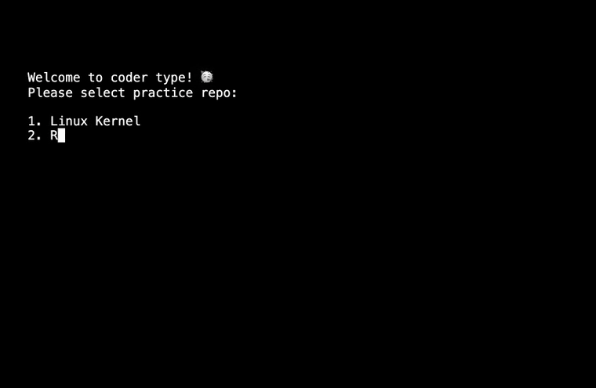
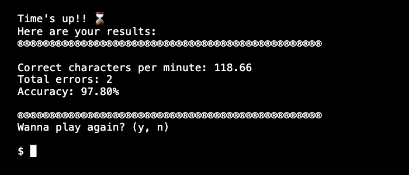

<div align="center">



# CoderType

**A typing game for programmers: instead of plain sentences you type real source code from Linux, React and TensorFlow, against a 45-second clock.**

[](https://coder-type-bogdus1k.vercel.app/)


[](LICENSE)

[Play online](https://coder-type-bogdus1k.vercel.app/) · [How it works](#how-it-works) · [Run it locally](#run-it-locally)

</div>

## How it works

1. A terminal greets you and asks which repository to practise on: **Linux Kernel**, **React** or **TensorFlow**.
2. It picks a real file from that repo and shows three lines at a time as a grey ghost. You type over it; correct characters turn white, mistakes count as errors, `Backspace` fixes them and `Enter` moves to the next line. Indentation is skipped for you.
3. After 45 seconds, or when you finish the snippet, you get your results and can play again.



**Results:** correct characters per minute, total errors and accuracy for the round.

## Tech stack

- Plain JavaScript modules, HTML and CSS: no framework and no runtime dependencies.
- The terminal and the editor are `<pre>` elements driven by a keydown listener, with one `<span>` per character.
- The code snippets live in [`data/`](data/) (`linux.js`, `react.js`, `tensorflow.js`).
- The deployed page loads a bundle built with [Parcel](https://parceljs.org/) (`index.*.js` and `index.*.css` in the root), because the source modules import each other without file extensions. Hosted on Vercel.

## Run it locally

```bash
git clone https://github.com/Bogdusik/CoderType.git
cd CoderType
python3 -m http.server 8000      # or: npx http-server
```

Open http://localhost:8000. `index.html` uses the committed bundle, so no build step is needed to play.

## Project structure

```
CoderType/
├── index.html          # Page: terminal, editor and stats panes; loads the bundle
├── index.js            # Game flow: choose a repo, play a round, show results, play again
├── editor.js           # Typing editor: ghost text, cursor, errors, paging, 45 s timer
├── terminal.js         # Terminal output and input with a typing animation
├── keyboard.js         # Key names
├── data/               # Code snippets per repository
├── styles/             # Source CSS (reset, theme, layout)
├── images/             # Favicon
└── index.*.js, *.css   # Parcel build output served in production
```

## What I learned

- **Vanilla JavaScript:** the whole game is DOM updates and one keydown listener, without a framework.
- **Typing-game mechanics:** comparing every key with the expected character, backspace, paging through a file and a fixed-length round.
- **Scoring:** correct characters per minute and accuracy from correct versus total keystrokes.
- **Terminal-style UI:** a typed-out terminal with a blinking cursor built from CSS and `<pre>` elements.

## License

[MIT](LICENSE)
